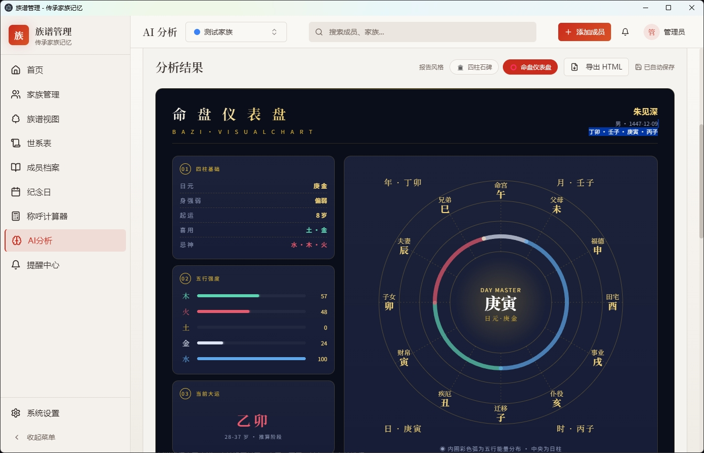
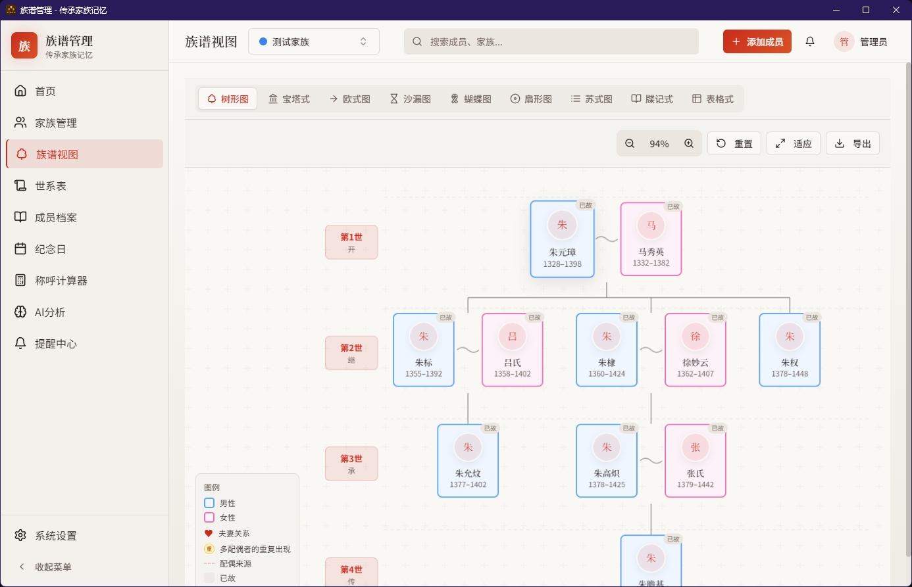
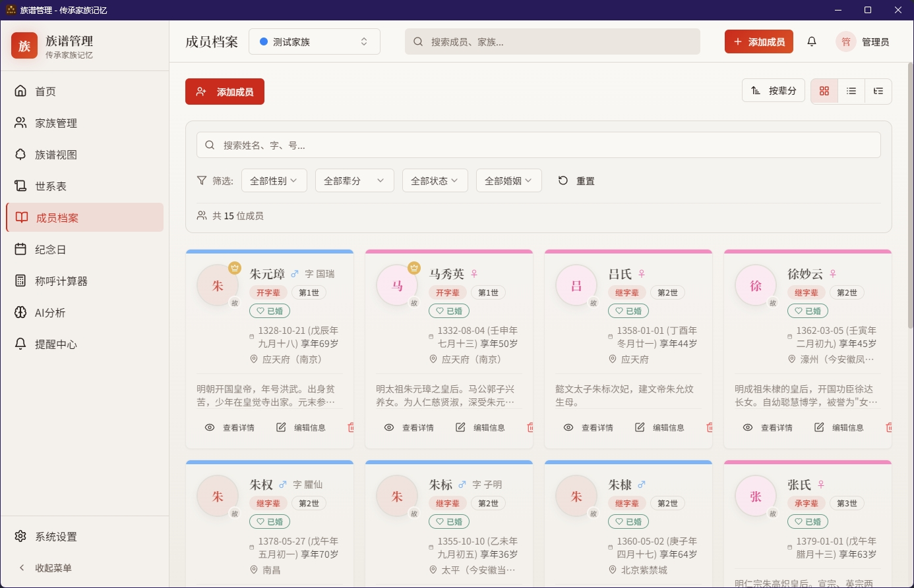
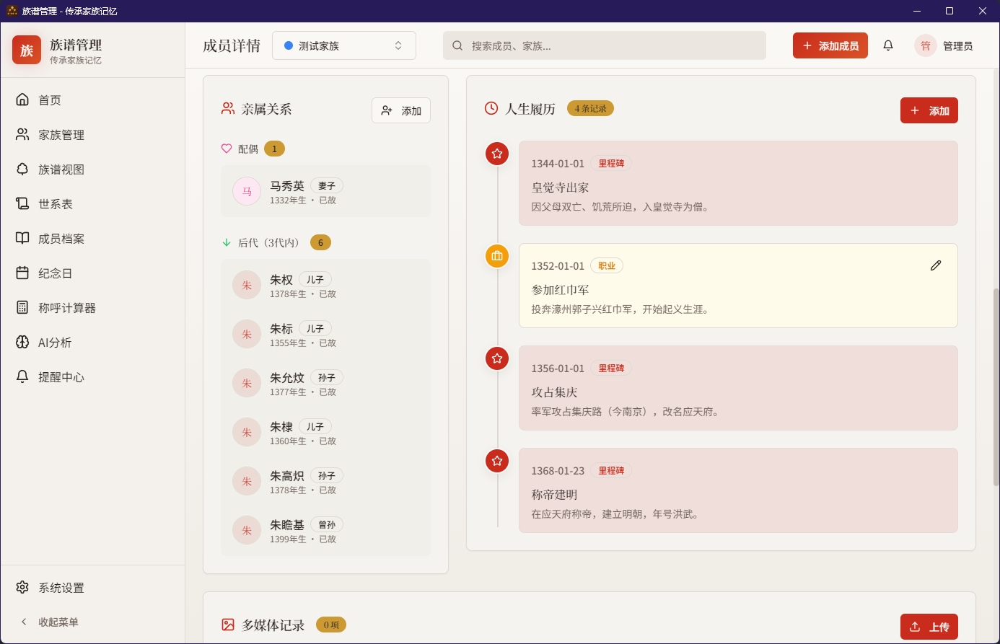

# 📜 族谱管理软件 — AI 智能家谱/族谱管理工具

🌐 **官方网站**: [https://familytree.design/zh/](https://familytree.design/zh/)

> **传承家族记忆 · 连接血脉亲情**  
> 融合 AI 技术的现代家谱/族谱管理桌面软件

## 🖼️ 软件截图

 | 
:---: | :---:
**可视化家族树** | **AI 八字命理测算**

 | 
:---: | :---:
**AI 遗传病风险分析** | **AI 智能起名**

---

## 📥 下载安装

### 全平台安装包

| 版本 | 平台 | 下载 |
|------|------|------|
| **v3.0.15** (最新) | 🪟 Windows (x64) | [⬇️ 下载安装包](https://github.com/gongjurenzhangwei/family-tree-ai-app/releases/download/v3.0.15/family-tree-design-3.0.15-win-x64.exe) |
| **v3.0.15** | 🍎 macOS (Apple Silicon) | [⬇️ 下载 dmg](https://github.com/gongjurenzhangwei/family-tree-ai-app/releases/download/v3.0.15/family-tree-design-3.0.15-mac-arm64.dmg) |
| **v3.0.15** | 🍎 macOS (Intel) | [⬇️ 下载 dmg](https://github.com/gongjurenzhangwei/family-tree-ai-app/releases/download/v3.0.15/family-tree-design-3.0.15-mac-x64.dmg) |
| **v3.0.15** | 🐧 Linux (x86_64) | [⬇️ 下载 AppImage](https://github.com/gongjurenzhangwei/family-tree-ai-app/releases/download/v3.0.15/family-tree-design-3.0.15-linux-x86_64.AppImage) |

> 支持 Windows 10 / Windows 11、macOS（按芯片选择 Apple Silicon 或 Intel 版本）与主流 Linux 发行版。下载后按系统常规方式安装即可。完整性校验文件见 Release 页面 Assets 中的 `SHA256SUMS.txt`。

---

## ✨ 功能特色

### 🌳 可视化家族树
- 自动生成**多代家族世系图谱**，清晰展示家族血脉传承
- 支持横向/纵向多种布局，交互式操作（拖拽、缩放、节点高亮）
- 支持**无限层级展开**，大族谱也能轻松驾驭

### 👤 成员档案管理
- 记录成员的**姓名、生卒日期、生平事迹、照片**等详细信息
- 支持**多配偶、过继、收养**等复杂家庭关系
- 可按**辈分、分支、居住地**等多种方式筛选查看

### 🤖 AI 八字命理测算
- 输入出生日期自动排盘，生成**八字四柱**命理分析
- AI 智能解读八字格局、五行喜忌、大运流年
- 结合**农历转换**（集成 lunar-javascript），精准推算

### 🧬 AI 遗传病风险分析
- 基于家族病史数据，AI 智能分析**遗传病风险**
- 支持遗传模式推断（常染色体显性/隐性、X连锁等）
- 为家族健康管理提供科学参考

### 🩸 AI 血型推断
- 根据父母血型，智能推断**后代可能血型及概率**
- 支持 ABO 血型系统 + Rh 血型系统
- 逆向推断：根据子女血型反推父母血型组合

### 📛 AI 智能起名
- 结合**八字五行**，AI 生成寓意美好的名字建议
- 支持**辈分用字**设定，符合族谱传统
- 提供名字寓意解释、音律分析、字形搭配评估

### 📅 纪念日日历与提醒
- 自动生成家族重要纪念日（生日、忌日、结婚纪念日等）
- 支持**农历/公历**双历显示
- 纪念日提醒功能，不再错过重要日子

### 🔢 亲威关系计算器
- 快速计算任意两位家族成员之间的**亲威关系**
- 自动生成关系称呼（如：堂叔伯、表舅、姑表兄等）
- 支持**传统九族五服**关系计算

### 🔒 数据安全与备份
- **数据本地存储**（基于 SQLite），无需联网，隐私无忧
- 支持**数据导入/导出/备份**，迁移方便
- 管理员密码保护，防止误操作

### 🎨 现代化界面
- 精致 UI 设计，支持**亮色/暗色**主题切换
- 中文字体优化，完美显示繁简体中文
- 操作流畅，响应迅速

---

## 🖥️ 关于软件

### 技术栈

| 技术 | 用途 |
|------|------|
| **Electron** | 桌面应用框架 |
| **React 18** | 前端 UI |
| **TypeScript** | 类型安全 |
| **Vite** | 构建工具 |
| **shadcn/ui + Tailwind CSS** | UI 组件与样式 |
| **better-sqlite3** | 本地数据库 |
| **i18next** | 国际化 |

### 作者

**工具人张伟**  
- B站: [@工具人张伟](https://space.bilibili.com/315615481)  
- 官网: [www.gongjurenzhangwei.com/zupu/](https://www.gongjurenzhangwei.com/zupu/)

---

## 📝 版本历史
### v3.0.15 (2026-10)
- 💍 **婚配序位**：配偶关系支持序位标记（原配 / 继配 / 三配…），亲属关系面板与族谱视图均按序位展示
- 👶 **子女出生排行**：排行标签统一维护，兄弟姐妹顺序一键上移 / 下移，族谱视图按排行展示
- 🖼️ **头像裁剪与查看**：上传头像支持自由裁剪，成员卡片 / 详情页可点击查看大图
- 📸 **媒体批量上传**：照片 / 音频 / 视频 / 文档支持一次多选、批量上传
- 🌙 修复农历闰月显示重复「闰」字的问题；🌐 修复世系表列设置 / 导出界面在部分语言下显示原始键名的问题
- 🍎🐧 自 v3.0 起新增 macOS / Linux 安装包、家族故事、A4 PDF 导出与全新品牌视觉
### v2.1.2 (2026-05)
- 🆕 AI 遗传病风险分析
- 🆕 AI 血型推断
- 🆕 AI 智能起名
- 🆕 纪念日日历与提醒
- 🆕 亲威关系计算器
- 🔧 界面优化与 Bug 修复

### v2.1.0 (2026-04)
- 🆕 AI 八字命理测算
- 🆕 数据导入导出备份
- 🔧 性能优化

### v2.0.0 (2026-03)
- 🆕 全新 UI 设计
- 🆕 重构世系图谱
- 🆕 支持多格式导出

---

## 🤝 反馈与支持

- 提交 [Issue](https://github.com/gongjurenzhangwei/family-tree-ai-app/issues) 反馈问题或建议
- 访问 [官网](https://www.gongjurenzhangwei.com/zupu/) 了解更多信息

---

  <b>传承家族记忆 · 连接血脉亲情</b>
   
  用科技守护家族历史，让每一代人的故事都被铭记
    
  <a href="https://www.gongjurenzhangwei.com/zupu/">🌐 官方网站</a> &nbsp;|&nbsp; <a href="https://github.com/gongjurenzhangwei/family-tree-ai-app/releases">📥 下载软件</a>

